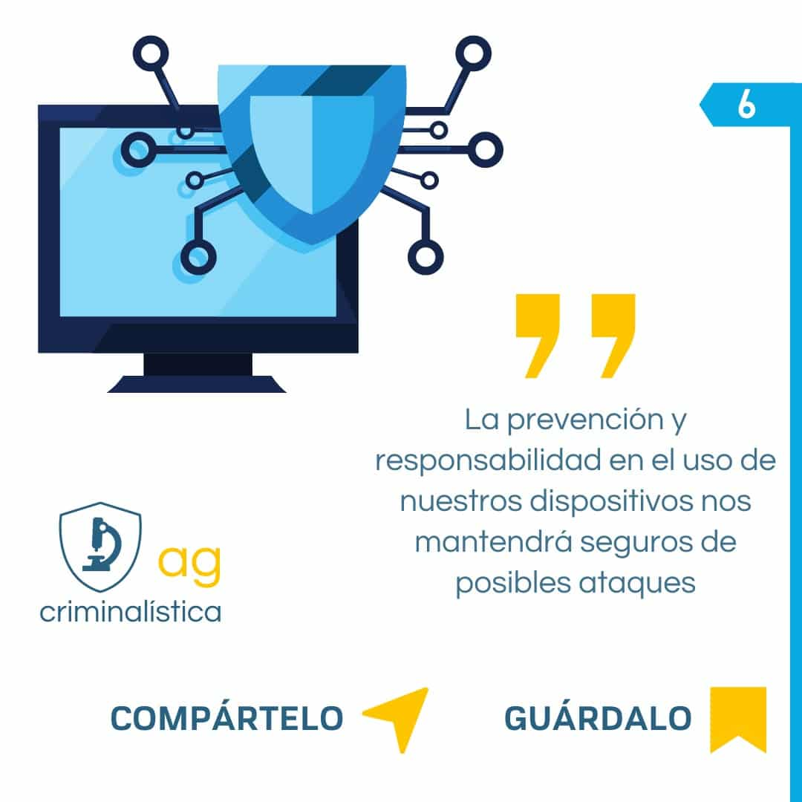

Vivimos el siglo de la información: enormes cantidades de datos transitan y se comparten por la red. Nunca antes en la historia de la humanidad pudimos comunicarnos de una manera tan eficaz y rápida.

La red de información digital interconectada se ha convertido en una parte integral de nuestra vida cotidiana y, a medida que nos volvemos dependientes de esta red, **también crece nuestra vulnerabilidad**.

> Conoce este y más términos relacionados con la criminalística siguiendo nuestro hashtag #crimidato en redes sociales.

La **ciberseguridad** se convierte entonces en el método mediante el cual protegemos nuestros sistemas o dispositivos conectados a la red contra el uso indebido o no autorizado de nuestros datos.

## Malware

Se trata de cualquier tipo de **código malicioso** diseñado para comprometer y vulnerar un dispositivo con el fin de ocasionar daños, robar datos o evitar controles de acceso.

## Claves de prevención

- Mantén actualizado el sistema operativo y las aplicaciones.
- Desconfía de enlaces y archivos adjuntos inesperados, aunque parezcan venir de alguien conocido.
- Usa contraseñas únicas y activa la verificación en dos pasos.
- Realiza copias de seguridad periódicas de tu información importante.

Si quieres profundizar en la investigación de delitos informáticos, revisa nuestro [curso de Informática Forense](/courses/informatica-forense/).
