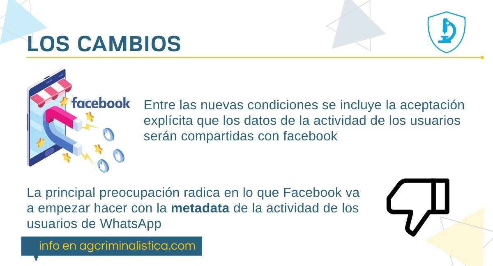

El 4 de enero, WhatsApp dio un ultimátum a sus usuarios: para continuar usando sus servicios debían aceptar las nuevas condiciones antes del 8 de febrero o abandonar la plataforma. La fecha límite fue posteriormente aplazada por la compañía en vista del aluvión de abandonos que empezó a sufrir la app de mensajería.

Los cambios en las condiciones del servicio abrieron el debate sobre el uso que hacen estas plataformas de los datos de sus usuarios. **Los metadatos se han convertido en la materia prima** para que plataformas como Facebook, propietaria de WhatsApp desde 2014, identifiquen los gustos y necesidades de sus usuarios con el objetivo de monetizar sus aplicaciones.

## Metadatos

Podemos definirlos como ***datos acerca de los datos***: suministran información, describen el contenido y caracterizan a un determinado dato. Altamente estructurados, describen características como contenido, calidad, circunstancias y atributos, y pueden clasificarse según varios criterios como el contenido, la variabilidad o la función.

Nunca antes estuvimos tan conectados a la red. Producimos ingentes cantidades de información cuando enviamos un mensaje, un audio o un video, subimos una foto, damos un *like* o compartimos nuestros gustos y lugares. Los datos crecen de forma exponencial, por lo que el big data, el internet de las cosas y el *cloud computing* han adquirido gran relevancia: la gestión de los metadatos ayuda a mejorar la eficiencia operativa y la toma de decisiones. El análisis y manejo del **big data** se ha impuesto como una de las actividades más rentables para las compañías que controlan este gran volumen de datos.

## ¿WhatsApp nos espía?

Según Ariadna Matamoros, profesora de medios digitales de la Universidad Tecnológica de Queensland (Australia), el último cambio en las condiciones del servicio es un intento por monetizar WhatsApp, y la única manera de hacerlo es transformándolo en un *e-commerce*; para ello, los datos de los usuarios son muy importantes.

Entre los datos que se recopilarán se encuentran el número de teléfono, idioma, modelo del dispositivo, ubicación y dirección IP, entre otros, que se empezarán a compartir con las demás plataformas de Facebook.

Este anuncio produjo una migración masiva de usuarios a plataformas como **Signal o Telegram**, que hasta el momento no han mostrado intenciones de seguir esos pasos y han demostrado tratar mejor la privacidad de sus usuarios.

Ante la migración, la app extendió la fecha límite y advirtió que las comunicaciones siguen siendo privadas porque se cifran de extremo a extremo.

## Lo gratuito se paga con datos

En un mundo cada vez más conectado necesitamos dar mayor relevancia al manejo que compañías como Facebook hacen de nuestros datos. Si un servicio se presenta como ***“gratuito”***, al final sí terminamos pagando: con nuestros datos y, por extensión, a costa de nuestra propia privacidad.

¿Hasta qué punto estamos dispuestos a ceder nuestra privacidad a cambio de esta clase de servicios “gratuitos”?
