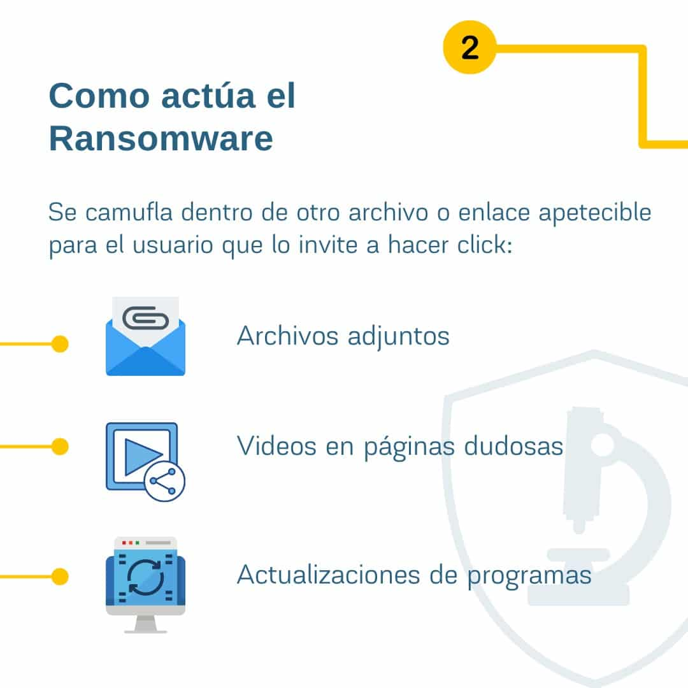

*Por Lcdo. Alberto Gutiérrez*

Era el año 1989 y los disquetes de 5,25 pulgadas vivían sus años de popularidad: representaban la manera más fácil y rápida de compartir información. Con la etiqueta “Disquete de información introductoria sobre el SIDA” (enfermedad identificada casi una década antes), **20 000 copias fueron distribuidas en unos 90 países** por correo postal. Al ejecutar el disquete, el usuario encontraba un cuestionario que le permitiría conocer si pertenecía a algún grupo con mayor riesgo de contraer VIH.

Al día siguiente, todos los que realizaron el cuestionario, al encender sus computadoras, se encontraron con una ventana roja y un mensaje que solicitaba “renovar la licencia”; mientras tanto, la máquina permanecería bloqueada. El programa había cifrado el disco duro y solo pagando 189 USD a una tal PC Cyborg Corporation se enviaría la clave para recuperar el control de los archivos. Empezaba así **el primer ataque ransomware de la historia**.

Con el acelerado desarrollo de las tecnologías de la información en las décadas siguientes evolucionaron también los medios de propagación, con técnicas más sofisticadas, mayores daños y rescates millonarios. En 2017, un ransomware atacó los sistemas de la española Telefónica, paralizando casi la totalidad de sus operaciones, presumiblemente mediante una campaña de *spam*: correos masivos con archivos o enlaces infectados que, con un simple clic, abrieron la puerta a los atacantes. Lo peor estaba por venir: los ciberdelincuentes convirtieron el virus en un gusano que se propagaba de forma automática por la red, afectando a cientos de empresas y organismos en más de 100 países, desde 40 hospitales en el Reino Unido hasta corporaciones en EE. UU., Portugal, Rusia, China, Italia, Japón o Alemania.

## La paralización de CNT, la pesadilla de toda empresa

El ataque informático sufrido por la **Corporación Nacional de Telecomunicaciones (CNT) del Ecuador** paralizó casi la totalidad de sus operaciones. Con los sistemas inutilizables, los empleados ni siquiera pudieron acceder con sus credenciales para realizar sus actividades diarias: compras y pagos a proveedores, incorporaciones y salidas de personal, recaudación de servicios, reconexiones e incluso servicios de otras instituciones como la Superintendencia de Compañías. Esto provocó pérdidas millonarias y puso en riesgo la información de todos sus clientes, aunque la entidad aseguró en un comunicado que los datos de sus usuarios “se encuentran debidamente resguardados” y reconoció que el ataque “afectó los procesos de atención” en sus Centros Integrados de Servicio y Contact Center.

La ministra responsable de telecomunicaciones confirmó que se trató de un virus de la familia **RansomEXX**. “Este tipo de amenazas atacan diversas instancias: el lugar físico, la red o las bases de datos”, indicó, y aclaró que en el caso de CNT “afectó únicamente a los sistemas informáticos”, por lo que se alteraron áreas como facturación, activaciones y recargas. El Gobierno decretó estado de emergencia institucional y la institución presentó la denuncia ante la Fiscalía para que se realicen las investigaciones periciales y forenses que permitan ubicar a los responsables.

## ¿Qué es el ransomware?

El [ransomware](https://www.instagram.com/p/CO36qHsFnIw/) es una de las formas de ataque más comunes y costosas. Se trata de un software malicioso que **“secuestra” un dispositivo** con toda la información que contiene, bloqueando el acceso a sus usuarios legítimos. Una vez toma el control, exige una recompensa para liberar los datos.

Pertenece a una familia más amplia conocida como [malware](https://www.instagram.com/p/CK7qWrTqFxZ/), software malicioso que casi siempre busca un beneficio económico. Ninguna empresa, ni siquiera los usuarios individuales, estamos libres de ser atacados, por lo que la sensibilización en ciberseguridad es fundamental.

En el caso de RansomEXX, el virus se sirve de un troyano que se esconde en archivos con suficiente espacio, como videos o software ilegal. Hoy, uno de los métodos más eficaces es el envío masivo de correos electrónicos, conocido como [phishing](https://www.instagram.com/p/CLsitsMBHbm/): si un empleado hace clic en el enlace o adjunto —inconscientemente o, en algunos casos, como cómplice— concede el acceso al software malicioso y comienza el secuestro de la información. Una vez infectado el sistema, los atacantes buscan permisos de administrador y propagan la infección cifrando todos los contenidos.

## ¿Son inevitables este tipo de ataques?

El caso de CNT pone de manifiesto un problema agravado a nivel mundial desde el inicio de la pandemia. Este mismo virus ya había atacado al ayuntamiento de Castelló (España), a la japonesa Konica Minolta, a petroleras en Indonesia y Brasil y al Departamento de Transporte de Texas (EE. UU.).

En ciberseguridad es fundamental entender los tres pilares de la seguridad informática de una organización, la **tríada CID**:

- **Confidencialidad:** garantiza la privacidad de los datos, restringiendo el acceso a la información únicamente al personal autorizado.
- **Integridad:** garantiza que la información sea precisa y confiable, sin alteraciones durante la transferencia ni modificaciones no autorizadas.
- **Disponibilidad:** garantiza que la información esté accesible para las personas autorizadas. Mantener los equipos, actualizar sistemas y software y crear respaldos asegura la disponibilidad de la red y los datos.

Los ciberdelincuentes son expertos en aprovechar las debilidades técnicas y organizacionales. Que un empleado haga clic en un enlace infectado es una **vulnerabilidad de la organización**: una persona con escasa formación en ciberseguridad. Estos comportamientos son comunes en todos los rangos, aunque los cargos gerenciales y directivos —con más permisos— suelen ser el objetivo preferido. La capacitación constante y los protocolos de actuación son fundamentales para reducir estas vulnerabilidades.

Proteger de forma absoluta a una organización no es factible: la experiencia necesaria para mantener la red segura es costosa y los criminales siempre encontrarán nuevas formas de atacar. Con el tiempo, un ataque sofisticado y dirigido tendrá éxito. Lo verdaderamente importante es **con qué rapidez** el equipo de seguridad puede responder para minimizar la pérdida de datos, el tiempo de inactividad y la pérdida de ingresos.

## Ecuador pierde el año en ciberseguridad

Lo ocurrido el 14 de julio en CNT no es nuevo; lo preocupante es que no se hayan tomado las medidas necesarias y que no se trate de un caso aislado. En febrero de 2021, Banco Pichincha, la mayor institución financiera del país, reconoció “un acceso no autorizado a los sistemas de un proveedor” de su programa Pichincha Miles. En una entrevista con [Bleeping Computer](https://www.bleepingcomputer.com/news/security/ransomware-gang-hacks-ecuadors-largest-private-bank-ministry-of-finance/), los atacantes de Hotarus Corp daban 13 días al banco para pagar el rescate por unos 80 GB de información y aseguraban haber vendido unas 37 000 tarjetas de crédito.

Según el **Índice Global de Ciberseguridad (GCI)**, Ecuador obtuvo 0,36 sobre 1, un nivel medio muy cercano al bajo (0,33), ocupando el puesto 15 de la región y el 98 a escala mundial. En Sudamérica se ubica octavo, solo por encima de Venezuela y Bolivia, mientras Uruguay lidera la región. El GCI lo elabora la [Unión Internacional de Telecomunicaciones (UIT)](https://www.itu.int/) y combina 25 indicadores sobre marco legal, entidades reguladoras, cooperación e investigación.

## Por qué el ataque a CNT debe preocuparnos a todos

Podríamos pensar que estos ataques nos perjudican solo si usamos los servicios de la empresa atacada, pero no estamos exentos de un ataque directo. Existen muchos ataques contra usuarios particulares que comprometen sus recursos económicos, desde [estafas](https://www.instagram.com/p/CQzjrZenYyy/) por canales digitales hasta el propio ransomware en nuestros dispositivos. Si instituciones como CNT o Banco Pichincha, con departamentos de TIC y expertos en ciberseguridad, sufren estos ataques, ¿cuál es el nivel de vulnerabilidad de un usuario promedio que muchas veces ni siquiera tiene un cortafuegos o un antivirus?

La [ciberseguridad](/ciberseguridad/) es el método mediante el cual protegemos nuestros sistemas y dispositivos contra el uso indebido o no autorizado de nuestros datos. La concientización de todos los usuarios de internet debe ser una prioridad de instituciones, organismos y del propio Estado. El solo uso de la red —redes sociales, WhatsApp, correo o servicios financieros— nos convierte en usuarios vulnerables y potenciales víctimas de los ciberdelincuentes.

## Referencias

- Banco Interamericano de Desarrollo (2020). *Ciberseguridad. Riesgos, avances y el camino a seguir en América Latina y el Caribe. Reporte de Ciberseguridad 2020.* BID, OEA: Observatorio de Ciberseguridad.
- CISCO Networking Academy (2020). *Introducción a la Ciberseguridad.* NETACAD.
- Di Iorio, A. (2017). *El rastro digital del delito: aspectos técnicos, legales y estratégicos de la informática forense.* Mar del Plata: Universidad FASTA Ediciones.

**Términos del glosario:** [Ransomware](/glosario/#ransomware) · [Evidencia digital](/glosario/#evidencia-digital) · [Informática forense](/glosario/#informatica-forense)
